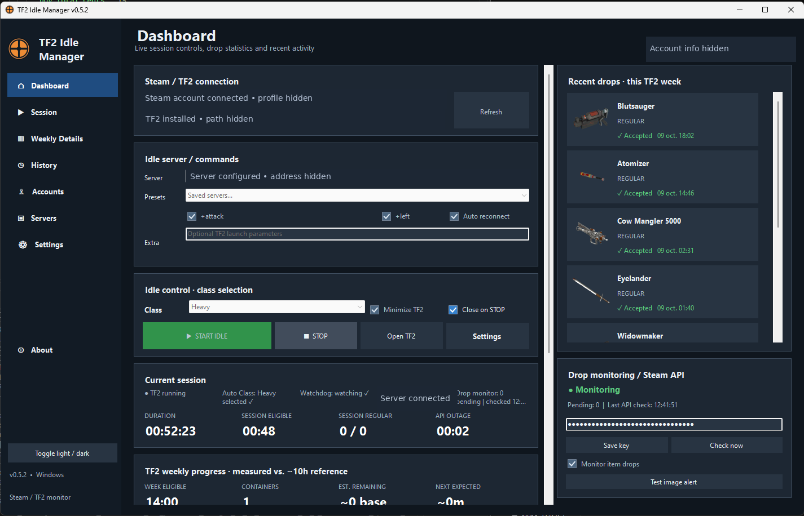
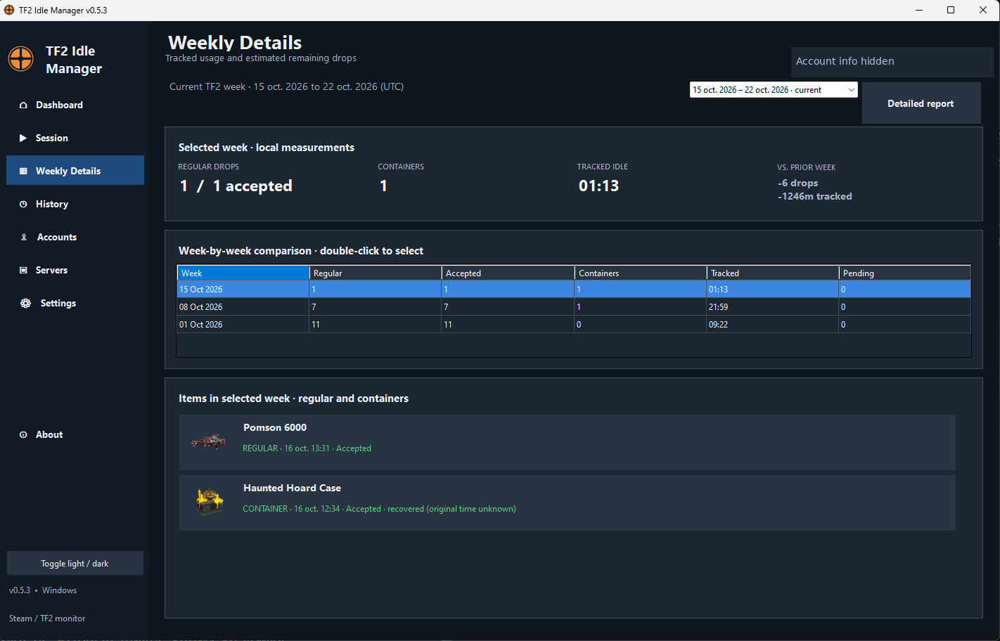
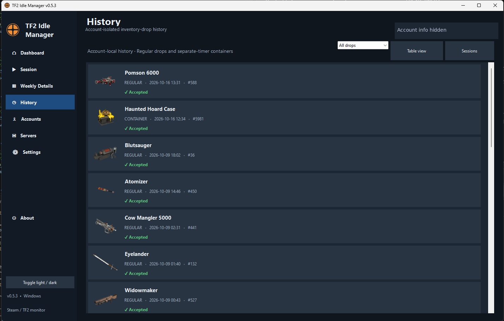

<p align="center">
  
</p>

<h1 align="center">TF2 Idle Manager</h1>

<p align="center">
  <strong>A portable Windows companion for Team Fortress 2 idle sessions and item-drop notifications.</strong><br />
  Automatically join community servers, recover interrupted sessions, and keep track of your drops.
</p>

<p align="center">
  <a href="https://github.com/SebaGutierrezF/tf2-idle-manager/releases/latest"></a>
  
  
  <a href="LICENSE"></a>
</p>

<p align="center">
  <a href="https://github.com/SebaGutierrezF/tf2-idle-manager/actions/workflows/windows-build.yml"></a>
  <a href="https://buymeacoffee.com/sebagutierrezf"></a>
</p>

<p align="center">
  <a href="https://github.com/SebaGutierrezF/tf2-idle-manager/releases/latest"><strong>⬇ Download latest release</strong></a>
  &nbsp;·&nbsp; <a href="#features">Features</a>
  &nbsp;·&nbsp; <a href="#screenshots">Screenshots</a>
  &nbsp;·&nbsp; <a href="#installation">Installation</a>
  &nbsp;·&nbsp; <a href="SECURITY.md">Security</a>
  &nbsp;·&nbsp; <a href="#build-from-source">Build from source</a>
</p>

---

## Preview

<p align="center">
  <a href="docs/screenshots/dashboard.png"></a>
</p>

> Screenshots are anonymized examples from validated pre-release v0.5.x builds; they illustrate the interface, not a claimed screenshot of the v1.0.0 executable.

## Features

| 🎮 Session automation | 🛡️ Smart recovery |
|:--|:--|
| Choose any TF2 class or **Random**, join a community idle server, and use configurable `+attack` / `+left`. **ESC before minimizing** helps release mouse focus. | Handle full or unavailable servers, reconnect after disconnects and map changes, and optionally fail over to saved servers. |

| 🔔 Drop notifications | 📊 Account-aware statistics |
|:--|:--|
| Receive drop notifications with **item names and images** when available. Pick one of four screen corners and optionally repeat alerts until the item is acknowledged. | Monitor **regular drops separately from cases/containers**, weekly estimates, tracked idle time and session history; data remains isolated by SteamID64. |

| 🎨 Desktop experience | 🔐 Local-first |
|:--|:--|
| Dark/light dashboard, item history with images, weekly comparison, **CSV export**, and a self-contained Windows portable release. | Steam Web API keys are encrypted locally with **Windows DPAPI**. An optional backup key can be configured. There is no custom telemetry backend. |

## Screenshots

<table>
  <tr>
    <td align="center" width="50%"><a href="docs/screenshots/weekly.png"></a><br /><strong>Weekly details</strong></td>
    <td align="center" width="50%"><a href="docs/screenshots/history.png"></a><br /><strong>Item history</strong></td>
  </tr>
</table>

See [more about these screenshots](docs/SCREENSHOTS.md).

## Installation

1. **[Get the latest release](https://github.com/SebaGutierrezF/tf2-idle-manager/releases/latest)** and download the **Windows x64 portable ZIP** under **Assets**. The current version is [v1.0.0](https://github.com/SebaGutierrezF/tf2-idle-manager/releases/tag/v1.0.0).
2. **Extract** the ZIP completely to a normal folder. Do not run the program from inside the ZIP.
3. Run **`TF2IdleManager.exe`**. The portable package contains the runtime; you do not need to install .NET 8 separately.
4. Make sure Steam and Team Fortress 2 are installed. Configure a community server and, for drop notifications, your Steam Web API key.
5. Pick a class and click **START IDLE**. Use **STOP** to end the managed session.

**Windows SmartScreen:** the binary is not code-signed. Verify its origin and the SHA-256 file in the release before running it; do not disable your security protections to run files you do not trust.

Read [PORTABLE.md](PORTABLE.md) for additional instructions.

## How drop tracking works

- The app monitors **unacknowledged TF2 items** via Steam Web API and shows a notification when it identifies a new pending item.
- **You must acknowledge the item manually in TF2.** The program does not auto-accept, buy, sell or trade items.
- Cases/containers are tracked separately from the regular weekly drop estimate.
- Valve's API can return **HTTP 503** or otherwise become unavailable; detection may be delayed during an outage. A second key cannot fix a Valve-wide outage.
- Next-drop timing and remaining weekly drops are **estimates**, not official Valve counters.

## Privacy and security

Your preferences, SteamID64-specific histories, session records and caches are stored locally under `%LOCALAPPDATA%\TF2IdleManager`. Steam Web API keys are encrypted using Windows DPAPI for your local Windows account. The public portable ZIP is audited to exclude personal settings, histories, API keys and logs.

⚠️ Logs and CSV exports **may contain SteamID64 values, timestamps and server addresses**. Please redact sensitive information before sharing them publicly.

Read the [privacy policy](PRIVACY.md), [security policy](SECURITY.md), and [support guide](SUPPORT.md).

## Build from source

Requirements: **Windows x64**, the **.NET 8 SDK**, PowerShell and Git (optional for cloning).

```bat
RUN_TESTS.bat
BUILD_RELEASE.bat
```

`BUILD_RELEASE.bat` runs offline regression tests, publishes a self-contained executable, audits an **exact allowlist** of distributed files, creates the portable ZIP and writes a SHA-256 checksum. **Do not bypass `AUDIT_RELEASE.ps1`.**

GitHub Actions also runs the Windows build and security audit. For local development, use `RUN_DEV.bat`.

## Contributing and support

Bug reports and feature suggestions are welcome via [Issues](https://github.com/SebaGutierrezF/tf2-idle-manager/issues). Please read [CONTRIBUTING.md](CONTRIBUTING.md) and [SUPPORT.md](SUPPORT.md). For suspected vulnerabilities, see [SECURITY.md](SECURITY.md) before reporting anything publicly.

<p align="center">
  <a href="https://buymeacoffee.com/sebagutierrezf"></a>
</p>

Supporting the project is **entirely optional** and does not affect access to its open-source features.

## License and disclaimer

Licensed under the **[MIT License](LICENSE)**. TF2 Idle Manager is an **unofficial community utility**, not affiliated with, endorsed by, or approved by Valve or Steam. Team Fortress 2/Steam names, artwork and trademarks belong to their respective owners. Follow the game and community-server rules.

---

<details>
<summary><strong>🇨🇱 Resumen en español</strong></summary>

**TF2 Idle Manager** es una aplicación portable para Windows que administra sesiones en servidores idle comunitarios de Team Fortress 2, selecciona clases y muestra notificaciones de objetos. También permite guardar servidores alternativos, recuperar desconexiones, consultar historial por cuenta y exportar estadísticas CSV.

1. Descarga el ZIP de **[Releases](https://github.com/SebaGutierrezF/tf2-idle-manager/releases/latest)** (no el ZIP automático de código fuente).
2. Descomprímelo y ejecuta `TF2IdleManager.exe`.
3. Configura Steam, TF2, un servidor y tu Steam Web API key para recibir alertas.
4. Inicia con **START IDLE**. Los objetos se reconocen **manualmente** dentro de TF2.

El programa separa los contenedores de los drops regulares, guarda el historial por SteamID64 y cifra las claves API mediante DPAPI. Las cifras de drops restantes son **estimaciones**, no límites oficiales. No está asociado a Valve.

Si deseas apoyar el desarrollo, puedes hacerlo mediante [Buy Me a Coffee](https://buymeacoffee.com/sebagutierrezf). Es completamente voluntario.

</details>
